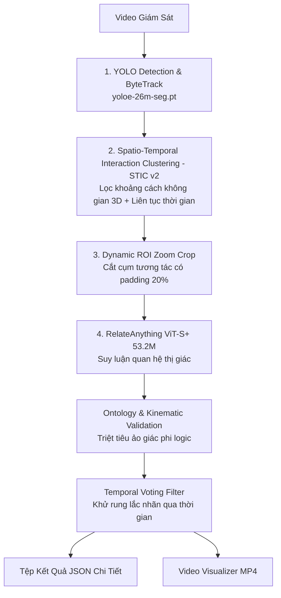

# BẢN BÀN GIAO & TỔNG KẾT DỰ ÁN (PROJECT MASTER HANDOVER)
**Dự án:** VidVRD RelateAnything — Phát Hiện Quan Hệ Tương Tác Thị Giác Trong Video Giám Sát  
**Cập nhật lần cuối:** 19/10/2026 (Chuẩn bị nghiệm thu kỳ thực tập ngày 22/10/2026)  
**Tác giả & Đơn vị:** Học viên AI Thực Chiến K3  
**Nguyên tắc cốt lõi:** Trung thực kỹ thuật, phản ánh đúng hiện trạng, không bịa đặt, không hardcode.

---

## 1. Bối Cảnh & Yêu Cầu Cốt Lõi Từ Mentor (15/10 - 16/10/2026)

### 1.1. Quyết định định hướng kỹ thuật
* **Loại bỏ nhánh VLM (Qwen2.5-VL):** Mô hình VLM 3B–4B quá nặng (~15GB VRAM), tốc độ xử lý chậm (~20s/frame), không thể chạy cục bộ end-to-end trên phần cứng máy trạm phổ thông. Nhánh này chỉ ghi nhận trong báo cáo như một thực nghiệm so sánh.
* **Chốt duy nhất nhánh RelateAnything (RA):** Sử dụng kiến trúc `maelic/relsgg-vits16plus` (DINOv3 ViT-S/16+, 53.2M tham số). Trọng số mô hình tải từ Hugging Face Hub (nằm tại `.cache/huggingface/hub/models--maelic--relsgg-vits16plus/`), nhẹ (~245MB), tốc độ suy luận nhanh (~20–35ms/frame).

### 1.2. Yêu cầu bàn giao sản phẩm của Mentor
1. **Đóng gói End-to-End (CLI):** Một câu lệnh duy nhất xử lý video từ đầu đến cuối, xuất ra JSON và video visualize:
   ```powershell
   python run.py --video data/videos/video2.mp4
   ```
2. **Cấu trúc JSON & Tách rời (Decoupled Offline Render):**
   * File JSON phải lưu trữ toạ độ từng frame của các đối tượng (`tracks`) và danh sách các quan hệ tương tác (`relations`).
   * Phải có script render video offline từ JSON mà không cần chạy lại mô hình AI:
     ```powershell
     python render_from_json.py --video_path data/videos/video2.mp4 --json_path data/output/full_video/video2/video2_relations.json --output_path data/output/video2_rendered.mp4
     ```
3. **Giao diện Web trực quan (Streamlit Localhost):**
   * Chạy cục bộ qua `streamlit run app.py`.
   * Hỗ trợ 2 chế độ: Chọn video mẫu có sẵn trong thư viện (Benchmark) và Tự tải lên video bất kỳ (Upload Custom).
   * Giao diện tinh gọn, vừa khít 1 màn hình (Zero-scroll), bảng theo dõi hiển thị rõ ID, đối tượng, số giây lần đầu xuất hiện và hành vi tương tác.

---

## 2. Cấu Hình Phần Cứng Thực Nghiệm & Môi Trường

* **Hệ điều hành:** Windows 10/11 64-bit.
* **Card đồ họa (GPU):** NVIDIA GeForce GTX 1650 Ti (4GB VRAM).
* **Môi trường Python:** Python 3.13 / Virtualenv `.venv`.
* **Thư viện AI cốt lõi:** PyTorch 2.6.0+cu124, Torchvision 0.21.0+cu124, Ultralytics (YOLO), Streamlit, OpenCV (`opencv-python`), Hugging Face `timm`, `transformers`.
* **Mức tiêu thụ tài nguyên thực tế:**
  * VRAM: ~2.2GB – 3.2GB (vừa vặn trong 4GB của GTX 1650 Ti).
  * Tốc độ: ~1.2 – 1.8x thời gian thực (video 39s chạy trong ~45s; video 94s chạy trong ~110s).

---

## 3. Kiến Trúc Pipeline Hiện Tại (4 Trụ Cột Kỹ Thuật)



1. **Phát hiện & Theo dõi (Detection & Tracking):**
   * Sử dụng `models/yoloe-26m-seg.pt` với cơ chế Bọc túi xách liên lớp (Bag Family: `backpack`, `handbag`, `suitcase`).
   * Phân biệt ngưỡng tạo track mới (`obj_spawn_conf = 0.40`) và ngưỡng duy trì vết (`obj_track_conf = 0.15`) để giảm phân mảnh ID.
2. **Gom cụm tương tác STIC v2 (Spatio-Temporal Interaction Clustering):**
   * Đánh giá tiếp xúc liên tục $D_{edge} \le \tau_{contact}$ và $IoU \ge 0.04$.
   * Tách biệt đối tượng tương tác ($|Cluster| \ge 2$) khỏi các vật thể tĩnh đơn lẻ (Singletons: xe đạp đỗ một chỗ, ô tô tĩnh, túi xách trên sàn).
3. **Cắt phóng Dynamic ROI Zoom:**
   * Cắt vùng Union Bounding Box kèm đệm ngữ cảnh 20%, đưa chi tiết bàn tay và vật thể nhỏ vào RelateAnything thay vì co giãn toàn khung hình làm mờ chi tiết.
4. **Bộ lọc bản thể học (Ontology) & Bỏ phiếu thời gian (Temporal Voting):**
   * Triệt tiêu quan hệ vô lý (người không cưỡi cặp sách, đồ vật không tự tương tác đồ vật).
   * Bỏ phiếu thời gian để nhãn quan hệ ổn định liên tục theo đoạn (time range `start_sec -> end_sec`).

---

## 4. Báo Cáo Hiện Trạng & Đánh Giá Trung Thực Các Video

| Video | Thời lượng | Thực thể | Quan hệ phát hiện | Đánh giá hiện trạng |
|---|---|---|---|---|
| **video1** | 73.0s | 12 | 6 (`carry`, `hold`) | Hoạt động tốt. Bắt chuẩn tương tác giữa 2 người và hành lý. |
| **video2** | 94.0s | 27 | 14 (`carry`, `hold`) | Ổn định. Đã triệt tiêu ảo giác gán nhãn `throw` rác ở giây 41. |
| **video3** | 87.0s | 22 | 16 (`ride`, `push`, `carry`) | Bắt được xe đẩy và hành khách. |
| **video4** | 39.0s | 6 | 3 (`carry`, `hold`, `pull`) | Tốt. Bắt được hành vi dắt/kéo xe đạp và mang túi. |
| **video7** | 160.0s | 18 | 8 (`carry`, `hold`) | Bắt chuẩn người mang túi vào phòng, túi tĩnh trên bàn được cô lập. |
| **video20** | 120.0s | 30 | 76 (`ride`, `hit`, `kick`, `hold`, ...) | Video ghép từ video 10-18: Bắt được nhiều quan hệ đa dạng nhưng còn nhiễu. |

> ⚠️ **Lưu ý trung thực từ người dùng (User Feedback):**
> * Thuật toán hiện tại **chưa hoàn hảo 100%**. Trên một số video mới (phân cảnh video 10–18), YOLO vẫn có lúc phát hiện thiếu hoặc sai đối tượng khi bị che khuất mạnh (occlusion).
> * Các hành vi động nhanh (như `hit`, `kick`, `throw`) hoặc hành vi chuyển trạng thái (`get_on`, `get_off`) có độ nhạy rất cao với góc quay camera, đòi hỏi tinh chỉnh thêm ngưỡng gom cụm và thời gian tiếp xúc.
> * Người dùng đang trực tiếp quan sát và phân tích các trường hợp lỗi để tiếp tục hiệu chỉnh.

---

## 5. Cấu Trúc Thư Mục Chuẩn Của Kho Mã Nguồn

```text
RelateAnything/
├── configs/
│   ├── relations.json            # 26 nhãn quan hệ VidVRD chuẩn hóa
│   ├── s_objects.json            # 60 lớp đối tượng chuẩn hóa
│   └── custom_bytetrack.yaml     # Tham số ByteTrack tối ưu surveillance
├── data/
│   ├── videos/                   # Thư viện video mẫu (video1, video2, ... video20.mp4)
│   ├── uploads/                  # Thư mục lưu video người dùng tải lên
│   └── output/                   # Kết quả xuất ra (full_video/<video_name>/)
│       └── full_video/
│           └── <video_name>/
│               ├── <video_name>_relations.json   # JSON toạ độ & quan hệ đầy đủ
│               └── <video_name>_visualizer.mp4  # Video MP4 đã vẽ bounding box & nhãn
├── models/
│   ├── yoloe-26m-seg.pt          # Trọng số YOLOE segmentation (chính thức)
│   └── osnet_x0_25.py            # Re-ID module hỗ trợ
├── modules/
│   └── spatial_clustering.py     # Thuật toán gom cụm STIC v2 & lọc không gian
├── relsgg/                       # Kiến trúc mạng nơ-ron RelateAnything
├── app.py                        # Giao diện Web Streamlit (Single-screen, Zero-scroll)
├── pipeline_relate_anything.py   # Pipeline xử lý AI chính (ROI Zoom + STIC)
├── render_from_json.py           # Script render MP4 offline từ JSON bằng CPU thuần (~3s)
├── run.py                        # Điểm khởi chạy dòng lệnh hợp nhất (Unified CLI)
├── README.md                     # Tài liệu hướng dẫn cài đặt & kỹ thuật chuẩn
└── PROJECT_MASTER_HANDOVER.md   # Tệp bàn giao dự án toàn diện này
```

---

## 6. Hướng Dẫn Vận Hành Hệ Thống

### 6.1. Kích hoạt môi trường
```powershell
.venv\Scripts\activate
```

### 6.2. Chạy dòng lệnh (CLI - End-to-End)
```powershell
# Chạy video bất kỳ trong thư viện:
python run.py --video data/videos/video2.mp4

# Chạy trích xuất JSON thuần không render video (siêu nhanh):
python run.py --video data/videos/video2.mp4 --no_render

# Render video từ file JSON bằng CPU thuần (mất ~3 giây, không tốn GPU):
python render_from_json.py --video_path data/videos/video2.mp4 --json_path data/output/full_video/video2/video2_relations.json --output_path data/output/full_video/video2/video2_cpu.mp4
```

### 6.3. Chạy giao diện Web (Streamlit)
```powershell
streamlit run app.py
```
* Mở trình duyệt tại `http://localhost:8501`.
* Chọn video mẫu hoặc upload video mới, bấm **🚀 Bắt Đầu Phân Tích**.
* Tải tệp JSON qua nút **`📥 Tải Tệp JSON (Full)`**.

---

## 7. Nguyên Tắc & Lưu Ý Cho Các AI Agent Kế Nhiệm

1. **Không commit hoặc push khi chưa có yêu cầu rõ ràng:** Luôn hỏi ý kiến người dùng trước khi thay đổi trạng thái git.
2. **Không làm màu / Không tâng bốc:** Không dùng các từ như "chắc chắn", "hoàn hảo", "vượt trội SOTA tuyệt đối". Luôn thừa nhận thẳng thắn các trường hợp biên (edge cases) và giới hạn phần cứng.
3. **Không làm đơ trình duyệt:** Không bao giờ truyền trực tiếp đối tượng JSON chứa >100.000 dòng toạ độ vào `st.json()`. Luôn tạo bản tóm tắt hoặc dùng nút tải xuống.
4. **Bảo mật thông tin:** Tuyệt đối không để lộ tên tổ chức nhạy cảm, tên mentor hoặc thông tin cá nhân trong code public và tài liệu.
