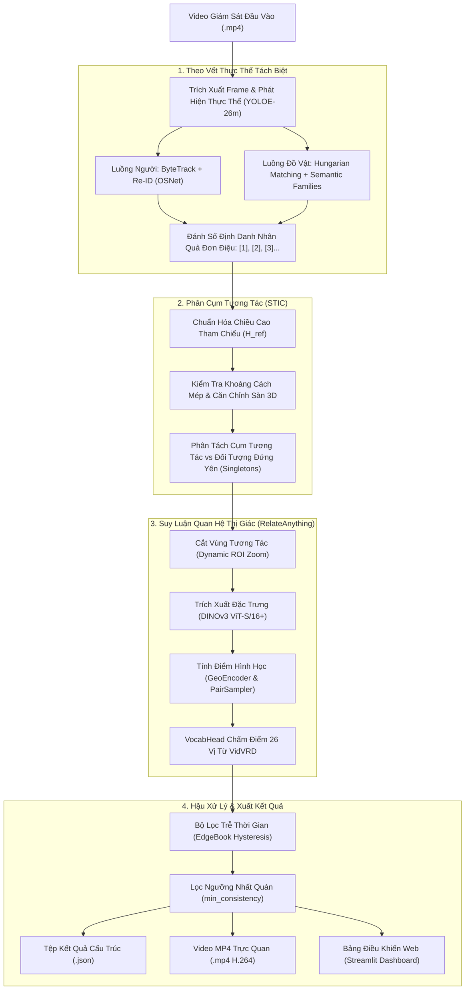

# VidVRD RelateAnything: Hệ Thống Nhận Diện Quan Hệ Thị Giác Trong Video Giám Sát

Dự án cung cấp một pipeline xử lý hoàn chỉnh (**End-to-End Pipeline**) cho bài toán **Nhận diện Quan hệ Thị giác trong Video (Video Visual Relationship Detection - VidVRD)**, ứng dụng vào luồng dữ liệu camera an ninh (CCTV). Hệ thống thực hiện việc phát hiện thực thể, theo dõi quỹ đạo chuyển động, phân cụm tương tác không gian - thời gian, và suy luận các quan hệ tương tác (chủ thể - vị từ - đối tượng) theo bộ từ vựng đóng gồm 60 lớp đối tượng và 26 vị từ quan hệ của tập dữ liệu chuẩn VidVRD.

Dự án được xây dựng và phát triển dựa trên mô hình nền tảng quan hệ thị giác **RelateAnything** ([arXiv:2609.12552](https://arxiv.org/abs/2609.12552), tác giả Maëlic Neau), kết hợp cùng bộ nhận diện đối tượng YOLOE-26m và thuật toán theo dõi ByteTrack / Hungarian Matching được tinh chỉnh cho dữ liệu giám sát video.

---

## Mục Lục
1. [Nguồn Gốc & Thừa Hưởng Từ Tác Giả Gốc](#1-nguồn-gốc--thừa-hưởng-từ-tác-giả-gốc)
2. [Kiến Trúc Hệ Thống & Sơ Đồ Khối](#2-kiến-trúc-hệ-thống--sơ-đồ-khối)
3. [Mô Hình RelateAnything & Cơ Chế Suy Luận](#3-mô-hình-relateanything--cơ-chế-suy-luận)
4. [Các Thuật Toán Cốt Lõi & Bảng Tham Số](#4-các-thuật-toán-cốt-lõi--bảng-tham-số)
   - [4.1. Chiều cao tham chiếu nhân trắc học ($H_{\text{ref}}$)](#41-chiều-cao-tham-chiếu-nhân-trắc-học-h_textref)
   - [4.2. Phân cụm tương tác không gian - thời gian (STIC)](#42-phân-cụm-tương-tác-không-gian---thời-gian-stic)
   - [4.3. Theo dõi thực thể tách biệt (Decoupled Tracking)](#43-theo-dõi-thực-thể-tách-biệt-decoupled-tracking)
   - [4.4. Lọc trôi thời gian & Hysteresis](#44-lọc-trôi-thời-gian--hysteresis)
5. [Cấu Trúc Thư Mục Dự Án](#5-cấu-trúc-thư-mục-dự-án)
6. [Cài Đặt Môi Trường](#6-cài-đặt-môi-trường)
7. [Hướng Dẫn Sử Dụng](#7-hướng-dẫn-sử-dụng)
   - [7.1. Chạy dòng lệnh (CLI Runner)](#71-chạy-dòng-lệnh-cli-runner)
   - [7.2. Giao diện Web Dashboard (Streamlit)](#72-giao-diện-web-dashboard-streamlit)
   - [7.3. Triển khai với Docker](#73-triển-khai-với-docker)
8. [Cấu Trúc Dữ Liệu Đầu Ra (JSON Schema)](#8-cấu-trúc-dữ-liệu-đầu-ra-json-schema)
9. [Phạm Vi Hoạt Động & Hạn Chế Đã Biết](#9-phạm-vi-hoạt-động--hạn-chế-đã-biết)
10. [Trích Dẫn & Bản Quyền](#10-trích-dẫn--bản-quyền)

---

## 1. Nguồn Gốc & Thừa Hưởng Từ Tác Giả Gốc

Dự án này là bản fork và mở rộng ứng dụng trên bài toán video từ công trình nghiên cứu:

* **Tên bài báo:** *RelateAnything: Real-Time Open-Vocabulary Relation Prediction From Any Inputs*
* **Tác giả:** Maëlic Neau ([arXiv:2609.12552](https://arxiv.org/abs/2609.12552), 2026)
* **Kho mã nguồn gốc:** [https://github.com/Maelic/RelateAnything](https://github.com/Maelic/RelateAnything)

### Đóng góp của tác giả gốc (RelateAnything Foundation):
- Kiến trúc mạng nơ-ron nền tảng quan hệ thị giác từ vựng mở (**RelSGG**) dựa trên visual backbone DINOv3 ViT-S/16+ kết hợp cơ chế chấm điểm hình học, lấy mẫu cặp tương tác (`PairSampler`), và đầu suy luận từ vựng (`VocabHead`) tính ma trận tương đồng cosine trực tiếp với text embeddings.
- Mô hình tách biệt hoàn toàn nhãn đối tượng khỏi khâu suy luận quan hệ, giúp tránh việc thiên kiến dữ liệu huấn luyện chi phối kết quả suy luận.

### Phần mở rộng trong kho lưu trữ này (VidVRD Surveillance Adaptation):
- Xây dựng luồng nhận diện và theo vết đối tượng tách biệt phù hợp với video giám sát (Người dùng ByteTrack + Re-ID, đồ vật dùng Hungarian Matching).
- Thiết kế thuật toán **Phân cụm tương tác không gian - thời gian (STIC)** để gom cụm các thực thể có khả năng tương tác vật lý và cô lập các đối tượng đứng yên / không liên quan (`Singletons`), giảm tải đáng kể số lượng cặp cần tính toán.
- Ràng buộc phân loại ngữ nghĩa theo đúng bộ quy tắc 26 vị từ và 60 đối tượng của benchmark VidVRD.
- Cơ chế lọc trôi thời gian (EdgeBook Hysteresis) để khử hiện tượng nhấp nháy nhãn (flicker) giữa các khung hình liên tiếp.
- Công cụ hiển thị trực quan hóa: Dựng video MP4 codec H.264 và bảng điều khiển trực quan qua Streamlit Dashboard.

---

## 2. Kiến Trúc Hệ Thống & Sơ Đồ Khối

Luồng xử lý toàn diện của pipeline được mô tả qua sơ đồ sau:



---

## 3. Mô Hình RelateAnything & Cơ Chế Suy Luận

Kiến trúc bên trong mô hình quan hệ thị giác **RelateAnything** (được trích xuất từ Hình 2 trong bài báo gốc của tác giả Maëlic Neau):


### Các khối thành phần chính:
1. **Visual Backbone (DINOv3 ViT-S/16+):**
   - Trích xuất đặc trưng dense patch từ 3 tầng độ sâu khác nhau (`[-6, -3, -1]`), chuẩn hóa qua LayerNorm và dung hợp bằng trọng số softmax học được.
2. **SoftSpatialPool:**
   - Gom cụm đặc trưng patch dưới các hộp bao để tạo biểu diễn riêng biệt cho chủ thể ($v_{\text{sub}}$), đối tượng ($v_{\text{obj}}$), vùng hợp nhất ($v_{\text{union}}$), và vùng tiếp xúc ($v_{\text{contact}}$).
3. **GeoEncoder:**
   - Mã hóa 19 đặc trưng hình học liên cặp (tọa độ tương đối, tỷ lệ diện tích, khoảng cách tâm, góc tiếp xúc) cùng với token mã hóa góc hộp Fourier.
4. **PairSampler:**
   - Rút gọn số lượng cặp ứng viên từ $O(N^2)$ xuống ngân sách giới hạn qua 2 giai đoạn:
     - Giai đoạn 1 (Geometry pre-scorer): Sử dụng MLP nhẹ trên đặc trưng hình học để giữ lại tối đa 400 cặp tiềm năng.
     - Giai đoạn 2 (Learned relatedness): Đánh giá khả năng tương tác bất đối xứng để chọn ra tối đa 128 cặp đưa vào transformer.
5. **RelationTransformer & Deformable Read:**
   - Thực hiện self-attention giữa các cặp ứng viên và cross-attention tới toàn cảnh để tạo vector biểu diễn quan hệ $r$ giàu ngữ cảnh.
6. **VocabHead (Suy luận từ vựng):**
   - Tính tích vô hướng trực tiếp giữa vector biểu diễn cặp thị giác sau chiếu $\text{proj}(r)$ với ma trận embedding văn bản chuẩn hóa $W$ của 26 vị từ VidVRD.
   - Quá trình suy luận không cần chạy mô hình ngôn ngữ lớn (LLM), đảm bảo tốc độ tính toán nhanh và tiết kiệm tài nguyên.
7. **Hàm tính điểm kết hợp (Dual Scoring):**
   - Điểm số quan hệ được kết hợp từ điểm logit vị từ ($s_{\text{pred}}$) và điểm liên đới hình học ($s_{\text{pair}}$):

     $$\text{score} = \sigma\left(a \cdot (s_{\text{pred}} + w \cdot s_{\text{pair}}) + b\right)$$

     *(trong đó $s_{\text{pred}}$ là `pred_logit`, $s_{\text{pair}}$ là `pair_logit`, và $\sigma$ là hàm kích hoạt sigmoid).*

---

## 4. Các Thuật Toán Cốt Lõi & Bảng Tham Số

### 4.1. Chiều cao tham chiếu nhân trắc học ($H_{\text{ref}}$)

Trong camera an ninh góc cao (CCTV), khoảng cách pixel bị co ngắn phi tuyến tính theo chiều sâu. Hệ thống tính toán chiều cao tham chiếu cục bộ:

$$
H_{\text{ref}} = \text{median}(\{h_i \mid h_i = y_{2, i} - y_{1, i} \ge 20\text{px}\})
$$

Nếu khung hình không có người, giá trị mặc định được gán bằng $0.25 \times H_{\text{frame}}$. Mọi khoảng cách kiểm tra tương tác sau đó đều được chuẩn hóa theo $H_{\text{ref}}$ nhằm đảm bảo tính bất biến theo cự ly camera.

*Vị trí mã nguồn:* [`modules/spatial_clustering.py`](modules/spatial_clustering.py) (`compute_anthropometric_reference_height`).

---

### 4.2. Phân cụm tương tác không gian - thời gian (STIC)

Hệ thống sử dụng các ngưỡng khoảng cách và điều kiện hình học để xác định các cặp thực thể có tiếp xúc vật lý hoặc tương tác:

| Tiêu Chí Tương Tác | Biểu Thức / Điều Kiện | Giá Trị Ngưỡng | Ý Nghĩa Kỹ Thuật | Vị Trí Mã Nguồn |
| :--- | :--- | :---: | :--- | :--- |
| **Người – Người** (Tạo cụm) | $d_{\text{edge}} \le$ `prox_thresh` | $\le 0.25 \cdot H_{\text{ref}}$ | Khoảng cách giới hạn tiếp xúc cơ thể giữa hai người. | [`spatial_clustering.py#L160`](modules/spatial_clustering.py#L160-L175) |
| **Người – Người** (Giải tán cụm) | $d_{\text{edge}} >$ `disband_thresh` | $> 0.45 \cdot H_{\text{ref}}$ | Bộ lọc trễ (Schmitt trigger) chống ngắt cụm đột ngột. | [`spatial_clustering.py#L164`](modules/spatial_clustering.py#L164-L178) |
| **Người – Người** (Độ sâu sàn 3D) | $\|y_{2, a} - y_{2, b}\| \le \Delta y_{\text{ground}}$ | $\le 0.35 \cdot H_{\text{ref}}$ | Hai người phải cùng tiếp xúc mặt sàn ở độ sâu tương đương. | [`spatial_clustering.py#L169`](modules/spatial_clustering.py#L169-L195) |
| **Người – Người** (Hướng di chuyển) | $\cos(\theta) = \frac{\vec{v}_a \cdot \vec{v}_b}{\|\vec{v}_a\| \|\vec{v}_b\|}$ | $\ge -0.20$ | Loại trừ trường hợp đi ngược chiều lướt qua nhau trong thời gian ngắn. | [`spatial_clustering.py#L205`](modules/spatial_clustering.py#L205-L215) |
| **Người – Đồ vật** (Tầm với tay) | $d_{\text{edge}} \le$ `reach_thresh` | $\le 0.15 \cdot H_{\text{ref}}$ | Tầm với tay vật lý của người tới đồ vật di chuyển. | [`spatial_clustering.py#L250`](modules/spatial_clustering.py#L250-L260) |
| **Cưỡi phương tiện** (Xe máy, xe đạp) | $\text{IoU} \ge 0.35, \Delta v \le 0.01 H_{\text{ref}}$ | Đồng tốc & đè diện tích | Người và phương tiện chuyển động đồng tốc và nằm đè lên nhau. | [`pipeline_relate_anything.py#L1480`](pipeline_relate_anything.py#L1480-L1530) |
| **Đồ vật tĩnh đứng yên** | $v < 0.005 \cdot H_{\text{ref}}$ | Vận tốc dịch chuyển | Đồ vật đặt trên sàn/bàn không di chuyển được tách thành Singleton. | [`pipeline_relate_anything.py#L2010`](pipeline_relate_anything.py#L2010-L2035) |

---

### 4.3. Theo dõi thực thể tách biệt (Decoupled Tracking)

| Mô-đun | Tham Số | Giá Trị Mặc Định | Chức Năng |
| :--- | :--- | :---: | :--- |
| **Phát hiện đối tượng** | YOLOE-26m (`--conf`) | `0.20` | Lọc các bounding box có độ tin cậy phát hiện từ 0.20 trở lên. |
| **Theo dõi đồ vật** | `OBJECT_SPAWN_CONF` | `0.40` | Ngưỡng tin cậy tối thiểu để sinh mới một chuỗi theo vết cho đồ vật. |
| **Duy trì đồ vật** | `OBJECT_TRACK_CONF` | `0.15` | Ngưỡng duy trì theo vết đối với đồ vật ở các frame bị che khuất nhẹ. |
| **Theo vết người** | ByteTrack High / Low | `0.25` / `0.10` | Hai tầng ngưỡng liên kết IoU cho người theo thuật toán ByteTrack. |
| **Khớp nối đồ vật** | Hungarian IoU | $\ge 0.15$ | Gán liên kết đồ vật qua ma trận chi phí Hungarian kết hợp lớp ngữ nghĩa tương đồng. |
| **Đặc trưng ngoại hình** | OSNet-x0.25 Re-ID Cosine | $\ge 0.76$ | Khâu nối vết người khi bị gián đoạn che khuất tạm thời. |
| **Định danh nhân quả** | Causal Agnostic ID | `[1]`, `[2]`, `[3]`... | Đánh số tăng đơn điệu theo thứ tự xuất hiện thời gian thực ($t_{\text{birth}}$). |

---

### 4.4. Lọc trôi thời gian & Hysteresis

- **Ngưỡng tin cậy quan hệ (`min_rel_conf`):** Mặc định `0.15`.
- **Ngưỡng nhất quán thời gian (`min_consistency`):** Mặc định `0.25` (hành vi phải duy trì trong ít nhất $25\%$ số frame của cụm tương tác).
- **Bộ lọc trễ EdgeBook Hysteresis:**
  - Đối với các hành vi tư thế duy trì dài (`hold`, `carry`, `ride`): Đặt ngưỡng bật cao ($on \approx 0.45$) và ngưỡng tắt thấp ($off \approx 0.30$) với hệ số trơn $\alpha = 0.35$ để chống rung giật nhãn.
  - Đối với các hành vi xung lực ngắn (`hit`, `kick`, `throw`, `get_on`, `get_off`): Hạ ngưỡng kích hoạt ($on \approx 0.20 - 0.35$, $\alpha = 0.85$) để ghi nhận kịp các tương tác ngắn.
  - Ràng buộc ngữ nghĩa (Selectional Constraints): Vị từ thuộc nhóm sinh học (`feed`, `kiss`, `bite`, `lick`) bị khóa khi đối tượng là vật vô tri.

---

## 5. Cấu Trúc Thư Mục Dự Án

```
RelateAnything/
├── run.py                          # Điểm chạy đơn giản của toàn bộ pipeline (CLI)
├── pipeline_relate_anything.py     # Động cơ pipeline chính (Tracking, STIC, RelateAnything)
├── app.py                          # Bảng điều khiển Web Dashboard (Streamlit)
├── modules/
│   ├── spatial_clustering.py       # Thuật toán STIC, tính toán H_ref và căn chỉnh hình học
│   └── appearance_reid.py          # Trích xuất đặc trưng ngoại hình Person Re-ID
├── models/
│   ├── osnet_x0_25.py              # Cấu trúc mạng OSNet cho Re-ID
│   ├── osnet_x0_25_msmt17.pth      # Trọng số mô hình Re-ID người
│   └── yoloe-26m-seg.pt            # Trọng số mô hình phát hiện YOLOE-26m
├── configs/
│   ├── s_objects.json              # Danh mục 60 lớp đối tượng VidVRD
│   ├── relations.json              # Danh mục 26 vị từ quan hệ VidVRD
│   └── custom_bytetrack.yaml       # Cấu hình siêu tham số ByteTrack
├── relsgg/                         # Thư viện mô hình RelateAnything gốc
├── data/
│   ├── videos/                     # Thư mục chứa các video đầu vào (MP4)
│   └── output/                     # Thư mục lưu kết quả xuất ra (JSON và Video MP4)
├── docs/                           # Tài liệu thiết kế kỹ thuật chi tiết
├── assets/                         # Sơ đồ kiến trúc và hình ảnh minh họa
├── Dockerfile                      # Cấu hình container hóa với Docker
├── docker-compose.yml              # Cấu hình triển khai nhanh với Docker Compose
├── requirements.txt                # Danh sách thư viện phụ thuộc Python
└── README.md                       # Tài liệu hướng dẫn sử dụng hệ thống
```

---

## 6. Cài Đặt Môi Trường

### Yêu cầu hệ thống:
- **Hệ điều hành:** Linux (Ubuntu 20.04/22.04) hoặc Windows 10/11.
- **Python:** Phiên bản 3.10 đến 3.12.
- **Phần cứng đề xuất:** Card đồ họa rời NVIDIA hỗ trợ CUDA 11.8 hoặc 12.x (tối thiểu 4GB VRAM để chạy mượt mà). Có thể chạy trên CPU thông qua cờ `--device cpu`.

### Các bước thiết lập:
```bash
# 1. Clone mã nguồn dự án
git clone https://github.com/higo-ai/RelateAnything.git
cd RelateAnything

# 2. Khởi tạo và kích hoạt môi trường ảo Python
python -m venv .venv
# Trên Windows PowerShell:
.\.venv\Scripts\Activate.ps1
# Trên Linux / macOS:
source .venv/bin/activate

# 3. Cài đặt PyTorch phù hợp với phiên bản CUDA của máy (ví dụ CUDA 12.4)
pip install torch torchvision --index-url https://download.pytorch.org/whl/cu124

# 4. Cài đặt các gói thư viện phụ thuộc
pip install -r requirements.txt

# 5. Cài đặt mô-đun relsgg ở chế độ editable
pip install -e . --no-deps
```

---

## 7. Hướng Dẫn Sử Dụng

### 7.1. Chạy dòng lệnh (CLI Runner)

Sử dụng tập lệnh [`run.py`](run.py) để chạy phân tích video:

```bash
# Chạy video với thiết bị CUDA (GPU)
python run.py --video data/videos/video1.mp4 --device cuda

# Chạy trên CPU nếu không có GPU rời
python run.py --video data/videos/video1.mp4 --device cpu

# Tùy chỉnh ngưỡng tin cậy phát hiện của YOLO (mặc định 0.20)
python run.py --video data/videos/video1.mp4 --conf 0.25
```

Kết quả được tự động lưu tại thư mục `data/output/full_video/<tên_video>/`:
- `<tên_video>_relations.json`: Tệp JSON chứa siêu dữ liệu, danh sách tracklet theo từng frame và các quan hệ được ghi nhận.
- `<tên_video>_visualizer.mp4`: Video được vẽ bounding box, nhãn thực thể và tên hành vi theo thời gian thực (chuẩn mã hóa H.264).

### 7.2. Giao diện Web Dashboard (Streamlit)

Khởi chạy ứng dụng web giám sát tương tác:

```bash
streamlit run app.py
```
Sau khi khởi chạy, mở trình duyệt web truy cập địa chỉ: **`http://localhost:8501`**

#### Các chức năng chính trên giao diện:
- **Trình phát video đồng bộ:** Phát trực tiếp video giám sát đã xử lý.
- **Bộ lọc quan hệ 3 chiều (Cascade Filter):** Lọc danh sách theo **Chủ thể (Subject)**, **Hành vi (Action)**, hoặc **Đối tượng (Object)**.
- **Tua video tức thời (Click-to-Seek):** Nhấn nút `Show on {X}s` tại từng thẻ quan hệ để trình phát video nhảy ngay đến thời điểm tương tác diễn ra.
- **Bảng thiết lập tham số:** Bấm nút menu ở góc phải để tùy chỉnh các ngưỡng `YOLO Conf`, `Relation Conf`, `Consistency Thresh`, và lựa chọn thiết bị tính toán (`Auto` / `CUDA` / `CPU`).
- **Tải file JSON:** Nút bấm tải trực tiếp tệp kết quả phân tích JSON về máy tính.

---

### 7.3. Triển khai với Docker

Dự án cung cấp sẵn cấu hình Docker để đóng gói toàn bộ môi trường chạy:

```bash
# Khởi chạy dịch vụ nền thông qua Docker Compose
docker compose up -d --build
```
Truy cập giao diện tại `http://localhost:8501`. Chi tiết tham số cấu hình xem thêm tại [DOCKER_GUIDE.md](DOCKER_GUIDE.md).

---

## 8. Cấu Trúc Dữ Liệu Đầu Ra (JSON Schema)

Dữ liệu JSON xuất ra có cấu trúc chuẩn như sau:

```json
{
  "video_metadata": {
    "video_name": "video1",
    "fps": 25.0,
    "total_frames": 2191,
    "resolution": [1920, 1080],
    "duration_sec": 73.0,
    "mode": "roi"
  },
  "tracks": {
    "[5]": {
      "track_id": "[5]",
      "type": "person",
      "class": "person",
      "trajectories": {
        "1117": [450, 210, 520, 480],
        "1118": [452, 211, 521, 482]
      }
    },
    "[7]": {
      "track_id": "[7]",
      "type": "object",
      "class": "handbag",
      "trajectories": {
        "1117": [490, 320, 530, 380]
      }
    }
  },
  "relations": [
    {
      "subject_id": "[5]",
      "subject_class": "person",
      "predicate": "carry",
      "object_id": "[7]",
      "object_class": "handbag",
      "confidence": 0.83,
      "temporal_consistency": 0.57,
      "time_range": {
        "start_sec": 37.4,
        "end_sec": 47.1
      },
      "active_frames": [1117, 1118, 1119]
    }
  ],
  "clusters": [
    {
      "cluster_id": "cluster_1",
      "entities": ["[5]", "[6]", "[7]"],
      "start_frame": 1100,
      "end_frame": 1450
    }
  ],
  "singletons": ["[1]", "[2]", "[3]", "[4]"]
}
```

---

## 9. Phạm Vi Hoạt Động & Hạn Chế Đã Biết

Nhằm phản ánh đúng năng lực thực tế của hệ thống, dưới đây là phạm vi phù hợp và một số hạn chế kỹ thuật hiện tại:

### Tình huống hoạt động ổn định:
- Video giám sát góc quay cố định với độ phân giải từ 720p trở lên, ánh sáng ban ngày hoặc trong nhà đầy đủ.
- Các hành vi tương tác phổ biến trong an ninh: cầm xách hành lý, di chuyển theo nhóm, tiếp xúc cơ thể gần, lên/xuống hoặc điều khiển phương tiện (xe đạp, xe máy).

### Các hạn chế kỹ thuật:
1. **Video hồng ngoại ban đêm:** Trong điều kiện thiếu sáng hoặc camera hồng ngoại đơn sắc, độ tương phản thấp khiến bộ nhận diện dễ bỏ sót đối tượng nhỏ hoặc gây ngắt quãng chuỗi theo vết.
2. **Che khuất sâu trong đám đông:** Khi nhiều đối tượng di chuyển đè lên nhau theo cùng một trục sâu quang học trong thời gian dài, việc phân tách biên giới tiếp xúc giữa các cá nhân có thể gặp nhầm lẫn.
3. **Đối tượng kích thước nhỏ ở cự ly xa:** Các vật thể có kích thước quá nhỏ (điện thoại, ví cầm tay) ở khoảng cách xa camera ($>15$ mét) có độ phân giải pixel thấp, dẫn đến việc khó phát hiện và theo vết liên tục.

---

## 10. Trích Dẫn & Bản Quyền

Nếu bạn sử dụng mã nguồn hoặc phương pháp trong dự án này, vui lòng trích dẫn các công trình gốc tương ứng:

```bibtex
@article{neau2026relateanything,
  title={RelateAnything: Real-Time Open-Vocabulary Relation Prediction From Any Inputs},
  author={Neau, Ma{\"e}lic},
  journal={arXiv preprint arXiv:2609.12552},
  year={2026}
}

@inproceedings{shang2017video,
  title={Video Visual Relation Detection},
  author={Shang, Xindi and Di, Tingwei and Xiao, Jun and Chua, Tat-Seng},
  booktitle={ACM International Conference on Multimedia (MM)},
  pages={1300--1308},
  year={2017}
}
```

Mã nguồn mô hình nền tảng RelateAnything tuân theo giấy phép do tác giả gốc quy định (tham khảo chi tiết tại [LICENSE](LICENSE) và [CITATION.cff](CITATION.cff)).
Các mô-đun mở rộng dành riêng cho tác vụ VidVRD trong kho lưu trữ này được phân phối dưới giấy phép mã nguồn mở của dự án.
