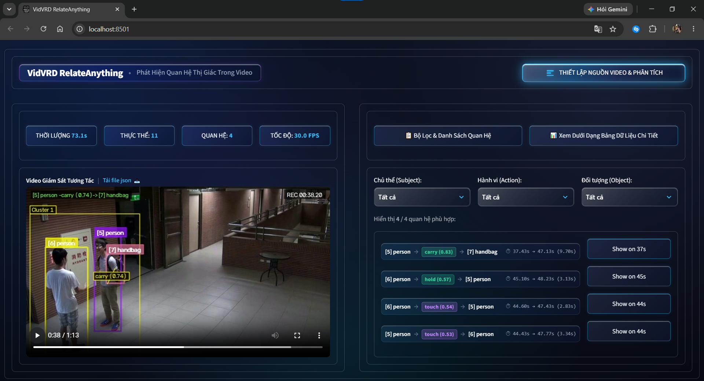
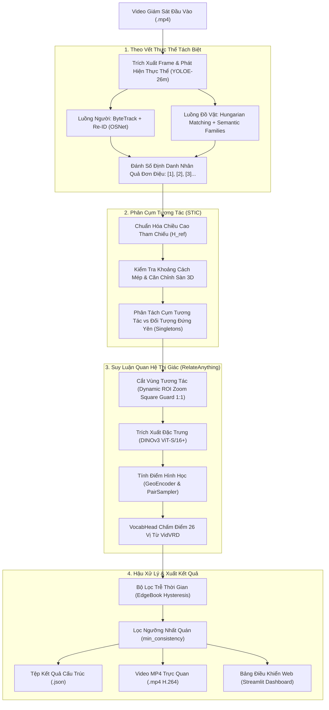
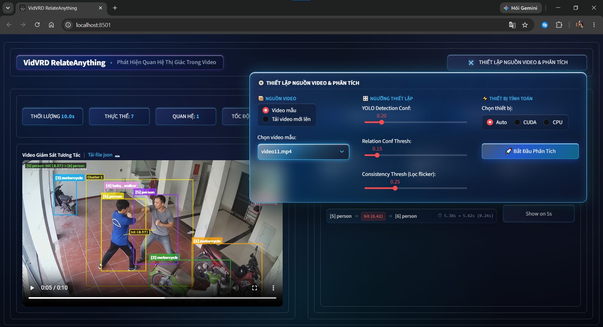

# VidVRD RelateAnything: Hệ Thống Nhận Diện Quan Hệ Thị Giác Trong Video Giám Sát CCTV

[](#)
[](LICENSE)
[](#)
[](#)
[](#)

Dự án cung cấp một đường ống xử lý hoàn chỉnh (**End-to-End Pipeline**) cho bài toán **Nhận diện Quan hệ Thị giác trong Video Giám sát (Video Visual Relationship Detection - VidVRD)** trên các luồng dữ liệu camera an ninh (CCTV). Hệ thống thực hiện việc phát hiện thực thể, theo dõi quỹ đạo chuyển động nhân quả, phân cụm tương tác không gian - thời gian, và suy luận các bộ ba quan hệ tương tác ⟨Chủ thể, Vị từ, Đối tượng⟩ theo bộ từ vựng đóng gồm 60 lớp đối tượng và 26 vị từ quan hệ chuẩn VidVRD.

Dự án được xây dựng và phát triển dựa trên mô hình nền tảng quan hệ thị giác **RelateAnything** ([arXiv:2609.12552](https://arxiv.org/abs/2609.12552), tác giả Maëlic Neau), kết hợp cùng bộ nhận diện đối tượng YOLOE-26m và hệ thống thuật toán động học nhân trắc học được tối ưu hóa cho môi trường camera an ninh thực tế.


*(Giao diện Web Dashboard: Trực quan hóa tương tác thực thể theo thời gian thực kết hợp bộ lọc và danh sách thẻ quan hệ phân loại theo danh mục chuẩn VidVRD).*

---

## Mục Lục
1. [Nguồn Gốc & Thừa Hưởng Từ Tác Giả Gốc](#1-nguồn-gốc--thừa-hưởng-từ-tác-giả-gốc)
2. [Kiến Trúc Hệ Thống & Sơ Đồ Khối](#2-kiến-trúc-hệ-thống--sơ-đồ-khối)
3. [Mô Hình RelateAnything & Cơ Chế Suy Luận Từ Vựng Mở](#3-mô-hình-relateanything--cơ-chế-suy-luận-từ-vựng-mở)
4. [Các Thuật Toán Cốt Lõi & Bảng Tham Số](#4-các-thuật-toán-cốt-lõi--bảng-tham-số)
   - [4.1. Chiều cao tham chiếu nhân trắc học (H_ref)](#41-chiều-cao-tham-chiếu-nhân-trắc-học-h_ref)
   - [4.2. Phân cụm tương tác không gian - thời gian (STIC)](#42-phân-cụm-tương-tác-không-gian---thời-gian-stic)
   - [4.3. Theo dõi thực thể tách biệt & Định danh nhân quả](#43-theo-dõi-thực-thể-tách-biệt--định-danh-nhân-quả)
   - [4.4. Lọc trôi thời gian EdgeBook Hysteresis & Khóa ngữ nghĩa](#44-lọc-trôi-thời-gian-edgebook-hysteresis--khóa-ngữ-nghĩa)
5. [Cấu Trúc Thư Mục Dự Án](#5-cấu-trúc-thư-mục-dự-án)
6. [Cài Đặt Môi Trường](#6-cài-đặt-môi-trường)
7. [Hướng Dẫn Vận Hành Hệ Thống](#7-hướng-dẫn-vận-hành-hệ-thống)
   - [7.1. Chạy dòng lệnh (CLI Runner)](#71-chạy-dòng-lệnh-cli-runner)
   - [7.2. Giao diện Web Dashboard (Streamlit)](#72-giao-diện-web-dashboard-streamlit)
   - [7.3. Triển khai với Docker](#73-triển-khai-với-docker)
8. [Cấu Trúc Dữ Liệu Đầu Ra (JSON Schema)](#8-cấu-trúc-dữ-liệu-đầu-ra-json-schema)
9. [Đánh Giá Thực Nghiệm & Kết Quả Benchmark](#9-đánh-giá-thực-nghiệm--kết-quả-benchmark)
   - [9.1. Benchmark mô hình nền tảng RelateAnything (Tác giả Maëlic Neau)](#91-benchmark-mô-hình-nền-tảng-relateanything-tác-giả-maëlic-neau)
   - [9.2. Đánh giá thực nghiệm Pipeline trên video giám sát an ninh](#92-đánh-giá-thực-nghiệm-pipeline-trên-video-giám-sát-an-ninh)
10. [Phân Tích Kỹ Thuật & Giới Hạn Hoạt Động](#10-phân-tích-kỹ-thuật--giới-hạn-hoạt-động)
    - [10.1. Bản chất kỹ thuật & Nguyên nhân sai số nhận diện](#101-bản-chất-kỹ-thuật--nguyên-nhân-sai-số-nhận-diện)
    - [10.2. Các giới hạn kỹ thuật hiện tại](#102-các-giới-hạn-kỹ-thuật-hiện-tại)
    - [10.3. Định vị phiên bản (v1.0.0 PoC) & Định hướng tiếp theo](#103-định-vị-phiên-bản-v100-poc--định-hướng-tiếp-theo)
11. [Trích Dẫn & Tuyên Bố Bản Quyền](#11-trích-dẫn--tuyên-bố-bản-quyền)
    - [11.1. Trích dẫn khoa học](#111-trích-dẫn-khoa-học)
    - [11.2. Giấy phép & Ghi nhận bản quyền (Attribution)](#112-giấy-phép--ghi-nhận-bản-quyền-attribution)
    - [11.3. Nguồn dữ liệu video kiểm chứng (Benchmark Video Datasets)](#113-nguồn-dữ-liệu-video-kiểm-chứng-benchmark-video-datasets)

---

## 1. Nguồn Gốc & Thừa Hưởng Từ Tác Giả Gốc

Dự án này kế thừa và phát triển mở rộng ứng dụng trên bài toán video từ công trình nghiên cứu:

* **Tên bài báo:** *RelateAnything: Real-Time Open-Vocabulary Relation Prediction From Any Inputs*
* **Tác giả:** Maëlic Neau ([arXiv:2609.12552](https://arxiv.org/abs/2609.12552), 2026)
* **Kho mã nguồn gốc:** [https://github.com/Maelic/RelateAnything](https://github.com/Maelic/RelateAnything)
* **Giấy phép gốc:** GNU Affero General Public License v3.0 (AGPL-3.0-only)

### 1.1. Đóng góp của tác giả gốc (RelateAnything Foundation):
- Kiến trúc mạng nơ-ron quan hệ thị giác từ vựng mở (**RelSGG**) dựa trên visual backbone DINOv3 ViT-S/16+ (53.2M tham số) kết hợp bộ mã hóa hình học (`GeoEncoder`), lấy mẫu cặp tương tác (`PairSampler`), và đầu suy luận từ vựng (`VocabHead`) tính tích vô hướng cosine trực tiếp với ma trận embedding văn bản $W$.
- Triết lý **Giải ghép (Decoupling):** Mô hình chỉ tiếp nhận ảnh và tọa độ bounding box hình học, không sử dụng nhãn phân loại của thực thể ($person$, $handbag$) trong quá trình suy luận quan hệ. Thiết kế này giúp hạn chế sự chi phối của phân phối tần suất nhãn trong tập huấn luyện.

### 1.2. Phần mở rộng trong kho lưu trữ này (VidVRD Surveillance Adaptation):
- **Theo vết tách biệt:** Tích hợp bộ theo vết ByteTrack kết hợp mạng Re-ID chuyên dụng cho người `OSNet-x0.25` và bộ ghép cặp Hungarian cho đồ vật dựa trên họ ngữ nghĩa (`SEMANTIC_FAMILIES`).
- **Chuẩn hóa nhân trắc học & STIC:** Xây dựng thuật toán phân cụm không-thời gian (STIC) dựa trên chiều cao tham chiếu nhân trắc học $H_{\text{ref}}$, căn chỉnh mặt phẳng sàn 3D, và khóa động học phương tiện cưỡi.
- **Dynamic Crisp ROI Zoom (Square Guard 1:1):** Phóng đại vùng tương tác cận cảnh theo tỉ lệ vuông 1:1, hạn chế biến dạng hình học khi chuẩn hóa về kích thước đầu vào DINOv3 ($448 \times 448$ px).
- **Bộ lọc EdgeBook Hysteresis & Khóa ngữ nghĩa:** Giảm thiểu hiện tượng rung giật nhãn giữa các khung hình liên tiếp và loại trừ các vị từ sinh học trên đồ vật vô tri.
- **Giao diện Web & Docker:** Cung cấp Dashboard Web Streamlit và đóng gói Docker môi trường CUDA 12.4.

---

## 2. Kiến Trúc Hệ Thống & Sơ Đồ Khối

Luồng xử lý toàn diện của pipeline được mô tả qua sơ đồ sau:



---

## 3. Mô Hình RelateAnything & Cơ Chế Suy Luận Từ Vựng Mở

Kiến trúc bên trong mô hình quan hệ thị giác **RelateAnything** (trích xuất từ bài báo gốc của tác giả Maëlic Neau):


### 3.1. Các khối thành phần chính:
1. **Visual Backbone (DINOv3 ViT-S/16+):** Trích xuất đặc trưng dense patch từ 3 tầng độ sâu khác nhau (`[-6, -3, -1]`), chuẩn hóa qua LayerNorm và dung hợp bằng trọng số softmax học được.
2. **SoftSpatialPool:** Gom cụm đặc trưng patch dưới các hộp bao để tạo biểu diễn riêng biệt cho chủ thể ($v_{\text{sub}}$), đối tượng ($v_{\text{obj}}$), vùng hợp nhất ($v_{\text{union}}$), và vùng tiếp xúc ($v_{\text{contact}}$).
3. **GeoEncoder:** Mã hóa 19 đặc trưng hình học liên cặp (tọa độ tương đối, tỷ lệ diện tích, khoảng cách tâm, góc tiếp xúc) cùng với token mã hóa góc hộp Fourier.
4. **PairSampler:** Cắt giảm số lượng cặp ứng viên từ $O(N^2)$ xuống ngân sách giới hạn qua 2 giai đoạn: Giai đoạn 1 (Geometry pre-scorer lọc giữ 400 cặp) $\to$ Giai đoạn 2 (Learned relatedness lọc giữ 128 cặp).
5. **RelationTransformer & Deformable Read:** Self-attention giữa các cặp ứng viên và cross-attention tới toàn cảnh để tạo vector biểu diễn quan hệ $r$ giàu ngữ cảnh.
6. **VocabHead (Suy luận từ vựng):** Tính tích vô hướng trực tiếp giữa vector biểu diễn cặp thị giác sau chiếu $\text{proj}(r)$ với ma trận embedding văn bản chuẩn hóa $W$ của 26 vị từ VidVRD.
7. **Hàm tính điểm kết hợp (Dual Scoring):**

$$
\text{score} = \sigma\left(a \cdot (s_{\text{pred}} + w \cdot s_{\text{pair}}) + b\right)
$$

   - $s_{\text{pred}}$: Điểm logit vị từ từ VocabHead.
   - $s_{\text{pair}}$: Điểm liên đới hình học từ PairSampler.
   - $\sigma$: Hàm kích hoạt sigmoid.

---

## 4. Các Thuật Toán Cốt Lõi & Bảng Tham Số

### 4.1. Chiều cao tham chiếu nhân trắc học (H_ref)

#### Lý do hệ thống cần chuẩn hóa theo $H_{\text{ref}}$:
Trong dữ liệu camera an ninh giám sát (CCTV), hệ tọa độ ảnh chỉ ghi nhận các giá trị điểm ảnh (pixel) mà không có cảm biến đo chiều sâu:
- Đối tượng ở **tiền cảnh (gần camera)** có kích thước hiển thị lớn (ví dụ chiều cao người $h \approx 400$ pixel).
- Đối tượng ở **hậu cảnh (xa camera)** có kích thước hiển thị nhỏ (ví dụ chiều cao người $h \approx 80$ pixel).
- Độ phân giải khung hình thay đổi tùy camera (từ 360p, 720p đến 1080p, 4K).

Nếu áp dụng một ngưỡng khoảng cách cố định theo pixel (ví dụ: gán cứng $\Delta = 50$ px):
- **Ở cự ly gần ($h \approx 400$ px):** $50$ px chỉ tương đương khoảng $\frac{50}{400} \times 1.7\text{ m} \approx 0.21\text{ m}$ ngoài thực tế. Ngưỡng này quá hẹp (quá khắt khe), buộc hai người phải đứng sát rạt gần như tiếp xúc trực tiếp mới đủ điều kiện ghép cặp.
- **Ở cự ly xa ($h \approx 80$ px):** $50$ px lại tương đương tới $\frac{50}{80} \times 1.7\text{ m} \approx 1.06\text{ m}$ ngoài thực tế. Ngưỡng này quá rộng (quá lỏng), khiến hai người đứng cách nhau hơn 1 mét trên mặt sàn vẫn bị gộp nhầm thành một cụm tương tác trên mặt phẳng ảnh 2D.

#### Nguyên lý tính toán $H_{\text{ref}}$:
Hệ thống tính chiều cao trung vị của các cá thể người xuất hiện trong cảnh quay để thiết lập đơn vị chuẩn $1.0 \cdot H_{\text{ref}}$ (quy ước tương đương chiều cao trung bình $\approx 1.7\text{ m}$ của người trưởng thành):

$$
H_{\text{ref}} = \text{median}\left(\{h_i \mid h_i = y_{2, i} - y_{1, i} \ge 0.04 \cdot H_{\text{frame}}\}\right)
$$

> [!NOTE]
> - Ngưỡng lọc thực thể người hợp lệ để tính $H_{\text{ref}}$ là $h_i \ge 0.04 \cdot H_{\text{frame}}$ (bất biến theo độ phân giải, tương đương $\approx 20\text{ px}$ trên video 480p hoặc $\approx 43\text{ px}$ trên video 1080p).
> - Trường hợp khung hình chưa xuất hiện đối tượng người, hệ thống gán giá trị dự phòng mặc định:
> $$H_{\text{ref}} = 0.25 \times H_{\text{frame}}$$

#### Phân định phương thức đo giữa các đối tượng:
1. **Tương tác Người – Người:**
   - Đo khoảng cách mép ngoài ngắn nhất ($D_{\text{edge}}$) giữa hai bounding box cơ thể (tính từ mép ngoài vai hoặc trang phục, không đo từ tâm hình học nhằm phản ánh chính xác ranh giới cơ thể bất kể thể trạng).
   - Ngưỡng kích hoạt cụm (`prox_interact_thresh`): $D_{\text{edge}} \le 0.25 \cdot H_{\text{ref}}$ ($\approx 0.42\text{ m}$ - chạm ranh giới Vùng Thân Mật theo lý thuyết Proxemics của Edward T. Hall), kết hợp cửa sổ trễ kích hoạt $\tau_{\text{form}} = 0.80$s để xác nhận tương tác liên tục.
   - Ngưỡng giải tán cụm (`prox_disband_thresh`): $D_{\text{edge}} > 0.45 \cdot H_{\text{ref}}$ ($\approx 0.76\text{ m}$ - bước ra ranh giới Vùng Cá Nhân), kết hợp bộ lọc trễ giải tán Schmitt trigger $\tau_{\text{disband}} = 0.50$s để chống đứt cụm do dao động bước chân.
   - Ghi đè tiếp xúc vật lý trực tiếp: Khi xảy ra tiếp xúc vật lý cận kề ($D_{\text{edge}} \le 0.05 \cdot H_{\text{ref}} \approx 8\text{ cm}$ hoặc $\text{IoU} > 0$), quy tắc phủ quyết ngược chiều bị vô hiệu hóa để không bỏ sót các hành vi bắt tay, ôm hay va chạm đối kháng.
   - Điều kiện mặt phẳng sàn 3D: Chênh lệch tọa độ chân không vượt quá $\Delta y_{\text{ground}} \le 0.35 \cdot H_{\text{ref}}$ nhằm đảm bảo hai cá thể cùng tiếp đất ở cùng một lát cắt chiều sâu quang học.

2. **Tương tác Người – Đồ vật:**
   - Đo khoảng cách từ mép cơ thể người đến mép ngoài của đồ vật ($D_{\text{edge}}$).
   - Phân loại dịch chuyển đồ vật (`disp_thresh`): Đồ vật có độ dịch chuyển $\ge 0.20 \cdot H_{\text{ref}}$ ($\approx 0.34\text{ m}$) được phân loại là đồ vật di động/mang vác (`carried / co-moved object`); dưới ngưỡng này được xem là đồ vật tĩnh nghỉ trên sàn/mặt bàn (`stationary resting object`).
   - Ngưỡng tầm với bàn tay (`reach_thresh`): $D_{\text{edge}} \le 0.15 \cdot H_{\text{ref}}$ ($\approx 0.25\text{ m}$ - bán kính thao tác và cầm nắm của bàn tay).
   - Đồ vật tĩnh tiếp sàn đứng yên (settled on floor): Đối với đồ vật tĩnh ($v < 0.005 \cdot H_{\text{ref}}/\text{s}$), chỉ ghi nhận tương tác khi người có hành vi dừng chân thực sự ($\ge 1.0$s) hoặc tiếp xúc xung lực trực tiếp ($d \le 0.04 \cdot H_{\text{ref}}$ trong $\ge 0.35$s). Khi đồ vật nằm ở cao độ chân sàn ($b_o[3] \ge b_s[3] - 0.12 \cdot H_{\text{ref}}$), hệ thống khóa trạng thái settled để ngắt các vị từ cầm nắm (`hold`, `carry`).
   - Ngoại lệ cưỡi phương tiện (`is_mountable`): Kiểm tra thân người nằm trên phương tiện ($b_s[1] < b_o[1]$, $b_s[1] + 0.45 h_s \ge b_o[1]$ và $b_s[3] \ge b_o[1] + 0.50 h_o$).

#### Bảng quy đổi tỷ lệ nhân trắc học:

| Tỷ lệ công thức | Ý nghĩa hình học cơ thể | Quy đổi thực tế ($H = 1.70$ m) | Ứng dụng trong thuật toán |
| :--- | :--- | :---: | :--- |
| **$0.04 - 0.05 \cdot H_{\text{ref}}$** | Tiếp xúc vật lý trực tiếp | $\approx 7 - 8$ cm | Va chạm cận kề $\to$ Ghi đè phủ quyết ngược chiều (bắt tay, va chạm). |
| **$0.15 \cdot H_{\text{ref}}$** | Bán kính bàn tay thao tác | $\approx 0.25$ m | Ngưỡng tầm với vật lý cho tương tác Người – Đồ vật (`reach_thresh`). |
| **$0.20 \cdot H_{\text{ref}}$** | Độ dịch chuyển tối thiểu | $\approx 0.34$ m | Ngưỡng phân loại đồ vật di động (`disp_thresh`) vs đồ vật tĩnh trên sàn. |
| **$0.25 \cdot H_{\text{ref}}$** | Vùng Thân Mật (Edward T. Hall) | $\approx 0.42$ m | Ngưỡng tiếp cận $\to$ Kích hoạt tạo cụm Người – Người (`prox_interact_thresh`). |
| **$0.35 \cdot H_{\text{ref}}$** | Lát cắt sàn 3D / Tầm với tối đa | $\approx 0.60$ m | Dung sai chênh lệch cao độ chân sàn ($\Delta y_{\text{ground}}$). |
| **$0.45 \cdot H_{\text{ref}}$** | Ranh giới Vùng Cá Nhân | $\approx 0.76$ m | Ngưỡng tách xa $\to$ Giải tán cụm Người – Người (`prox_disband_thresh`). |
| **$0.005 \cdot H_{\text{ref}}/\text{s}$** | Ngưỡng vận tốc đứng yên | $\approx 0.8$ cm/s | Nhận diện dừng chân (dwell) để phân biệt tương tác vs người đi ngang qua. |

---

### 4.2. Phân cụm tương tác không gian - thời gian (STIC)

Hệ thống sử dụng các điều kiện hình học và động học để xác định các cặp thực thể có tương tác thực sự:

| Tiêu Chí Tương Tác | Biểu Thức / Điều Kiện | Giá Trị Ngưỡng | Ý Nghĩa Kỹ Thuật | Vị Trí Mã Nguồn |
| :--- | :--- | :---: | :--- | :--- |
| **Người – Người** (Tạo cụm) | $d_{\text{edge}} \le$ `prox_thresh` | $\le 0.25 \cdot H_{\text{ref}}$ | Chạm ranh giới vùng thân mật ($\tau_{\text{form}} = 0.80$s) để kích hoạt cụm. | [`spatial_clustering.py#L163`](modules/spatial_clustering.py#L163-L173) |
| **Người – Người** (Giải tán cụm) | $d_{\text{edge}} >$ `disband_thresh` | $> 0.45 \cdot H_{\text{ref}}$ | Bộ lọc trễ (Schmitt trigger debounce $\tau_{\text{disband}} = 0.50$s) chống ngắt cụm đột ngột. | [`spatial_clustering.py#L164`](modules/spatial_clustering.py#L164-L176) |
| **Tiếp xúc trực tiếp** | $d_{\text{edge}} \le 0.05 \cdot H_{\text{ref}}$ hoặc $\text{IoU} > 0$ | $\le 0.05 \cdot H_{\text{ref}}$ | Ghi đè phủ quyết ngược chiều khi có tiếp xúc cơ thể (bắt tay, va chạm). | [`spatial_clustering.py#L212`](modules/spatial_clustering.py#L212-L214) |
| **Căn chỉnh sàn 3D** | $\|y_{2, a} - y_{2, b}\| \le \Delta y_{\text{ground}}$ | $\le 0.35 \cdot H_{\text{ref}}$ | Hai thực thể phải cùng tiếp xúc mặt sàn ở cùng lát cắt chiều sâu quang học. | [`spatial_clustering.py#L169`](modules/spatial_clustering.py#L169-L191) |
| **Hướng di chuyển** | $\cos(\theta) = \frac{\vec{v}_a \cdot \vec{v}_b}{\|\vec{v}_a\| \|\vec{v}_b\|}$ | $\ge -0.20$ | Loại trừ người đi ngược chiều lướt qua nhau trong chớp mắt. | [`spatial_clustering.py#L204`](modules/spatial_clustering.py#L204-L210) |
| **Người – Đồ vật** (Tầm với tay) | $d_{\text{edge}} \le$ `reach_thresh` | $\le 0.15 \cdot H_{\text{ref}}$ | Tầm với tay vật lý của người tới đồ vật di chuyển ($\approx 0.25$ m). | [`spatial_clustering.py#L253`](modules/spatial_clustering.py#L253-L275) |
| **Phân loại dịch chuyển vật** | $\text{disp} \ge$ `disp_thresh` | $\ge 0.20 \cdot H_{\text{ref}}$ | Phân tách đồ vật được mang vác/đồng chuyển động vs đồ vật tĩnh trên sàn. | [`spatial_clustering.py#L250`](modules/spatial_clustering.py#L250-L260) |
| **Cưỡi phương tiện** | Thân người trên yên, đè diện tích | $\text{IoU} > 0$ hoặc $d \le 0.02 H_{\text{ref}}$ | Người và phương tiện liên kết vật lý (yên xe và gác chân). | [`spatial_clustering.py#L298`](modules/spatial_clustering.py#L298-L301) |
| **Đồ vật tĩnh đứng yên** | Vận tốc $v < 0.005 \cdot H_{\text{ref}}/\text{s}$ | Trạng thái settled | Khóa trạng thái khi ở sàn/bàn, cô lập thành Singleton khi không có tương tác. | [`pipeline_relate_anything.py#L2016`](pipeline_relate_anything.py#L2016-L2053) |
| **Ghép cụm Episode thời gian** | Cùng thực thể & $\Delta t \le \tau_{\text{slack}}$ | $\tau_{\text{slack}} = 2.5$s | Ngăn chặn chuỗi bắc cầu qua thời gian, phân tách các đợt tương tác độc lập. | [`spatial_clustering.py#L400`](modules/spatial_clustering.py#L400-L437) |

---

### 4.3. Theo dõi thực thể tách biệt & Định danh nhân quả

1. **Bộ theo vết người:** Sử dụng ByteTrack kết hợp trích xuất đặc trưng ngoại hình `OSNet-x0.25` ($D=512$, MSMT17 weights). Tích hợp hai cơ chế bảo vệ:
   - *Extraction Quality Gate:* Chỉ lấy mẫu Re-ID Gallery khi cơ thể không bị cắt mép cửa ($h/w \ge 1.70$, $w \ge 10$, $h \ge 25$, cách biên khung hình $\ge 2\%$).
   - *Biomechanical Dwell Time Gate:* Khi khoảng hở tại cổng $\Delta t < 0.50$s, đảo chiều vận tốc $\cos\theta < 0$, và độ tương đồng ngoại hình $\text{sim}_{\text{reid}} < 0.80$, hệ thống xác định là 2 cá thể độc lập (khắc phục lỗi tráo ID tại cửa ở Video 1). Ngưỡng ghép nối thông thường yêu cầu $\text{sim}_{\text{reid}} \ge 0.68$.
2. **Bộ theo vết đồ vật:** Sử dụng thuật toán tối ưu Hungary kết hợp Họ ngữ nghĩa (`SEMANTIC_FAMILIES` trong `configs/s_objects.json`) để chống đứt vết khi detector nhấp nháy nhãn giữa `backpack` và `handbag`.
3. **Định danh nhân quả (Causal Agnostic Decoupled ID):** Cấp phát ID tăng đơn điệu `[1]`, `[2]`, `[3]`... theo thời điểm xuất hiện thực tế ($t_{\text{birth}}$), tách rời định danh vô ngã với thuộc tính phân loại động.

---

### 4.4. Lọc trôi thời gian EdgeBook Hysteresis & Khóa ngữ nghĩa

- **Bộ lọc trễ EdgeBook Hysteresis:**
  - Đối với các hành vi tư thế duy trì dài (`hold`, `carry`, `ride`): Đặt ngưỡng bật cao ($on \approx 0.45$) và ngưỡng tắt thấp ($off \approx 0.30$) với hệ số làm mịn EMA $\alpha = 0.35$ để chống rung giật nhãn giữa các frame liên tiếp.
  - Đối với các hành vi xung lực ngắn (`hit`, `kick`, `throw`): Hạ ngưỡng kích hoạt ($on \approx 0.20 - 0.35$, $\alpha = 0.85$) để ghi nhận kịp các tương tác nhanh ($0.15$s).
- **Ràng buộc ngữ nghĩa (Selectional Restrictions - Chomsky 1965):** Khóa hoàn toàn các vị từ sinh học/tiêu hóa (`feed`, `kiss`, `bite`, `lick`) khi đối tượng là vật vô tri (triệt tiêu ảo giác `person feed handbag`).
- **Ngưỡng nhất quán thời gian (`min_consistency`):** Mặc định `0.25` (hành vi phải duy trì trong ít nhất 25% số frame của cụm).

---

## 5. Cấu Trúc Thư Mục Dự Án

```
RelateAnything/
├── run.py                          # Điểm chạy đơn giản của toàn bộ pipeline (CLI)
├── pipeline_relate_anything.py     # Động cơ pipeline chính (Detection, Tracking, STIC, RelateAnything)
├── app.py                          # Bảng điều khiển Web Dashboard (Streamlit)
├── modules/
│   └── spatial_clustering.py       # Thuật toán STIC, tính toán H_ref và căn chỉnh hình học
├── models/
│   ├── osnet_x0_25.py              # Cấu trúc mạng OSNet cho Re-ID
│   ├── osnet_x0_25_msmt17.pth      # Trọng số mô hình Re-ID người (9.3 MB)
│   └── yoloe-26m-seg.pt            # Trọng số mô hình phát hiện YOLOE-26m (70.4 MB)
├── configs/
│   ├── s_objects.json              # Danh mục 60 lớp đối tượng VidVRD & Semantic Families
│   ├── relations.json              # Danh mục 26 vị từ quan hệ chuẩn VidVRD
│   └── custom_bytetrack.yaml       # Cấu hình tham số ByteTrack
├── relsgg/                         # Thư viện mô hình RelateAnything gốc
├── data/
│   ├── videos/                     # Chứa 8 video giám sát mẫu đầu vào (.mp4)
│   └── output/                     # Thư mục lưu kết quả sau khi chạy (JSON và Video H.264)
├── Dockerfile                      # Cấu hình container hóa môi trường PyTorch 2.4.0 + CUDA 12.4
├── docker-compose.yml              # Khởi chạy dịch vụ một lệnh với Docker Compose
├── requirements.txt                # Danh sách thư viện phụ thuộc Python
└── README.md                       # Tài liệu hướng dẫn sử dụng hệ thống
```

---

## 6. Cài Đặt Môi Trường

### Yêu cầu hệ thống:
- **Hệ điều hành:** Linux (Ubuntu 20.04/22.04) hoặc Windows 10/11.
- **Python:** Phiên bản 3.10 đến 3.12.
- **Phần cứng đề xuất:** Card đồ họa rời NVIDIA hỗ trợ CUDA 11.8 hoặc 12.x (tối thiểu 4GB VRAM). Có thể chạy trên CPU thông qua cờ `--device cpu`.

### Các bước thiết lập:
```bash
# 1. Clone mã nguồn dự án
git clone https://github.com/higo-ai/RelateAnything.git
cd RelateAnything

# 2. Khởi tạo và kích hoạt môi trường ảo Python
python -m venv .venv
# Trên Windows:
.venv\Scripts\activate
# Trên Linux / macOS:
source .venv/bin/activate

# 3. Cài đặt PyTorch phù hợp với phiên bản CUDA của máy (ví dụ CUDA 12.4)
pip install torch torchvision --index-url https://download.pytorch.org/whl/cu124

# 4. Cài đặt các gói thư viện phụ thuộc
pip install -r requirements.txt

# 5. Cài đặt mô-đun relsgg ở chế độ editable
pip install -e . --no-deps
```

---

## 7. Hướng Dẫn Vận Hành Hệ Thống

> [!TIP]
> **Kích hoạt môi trường ảo:** Trước khi thực thi các lệnh dòng lệnh (CLI) hoặc ứng dụng Web, luôn đảm bảo môi trường ảo `.venv` đã được kích hoạt trong cửa sổ dòng lệnh hiện tại:
> - Trên Windows: `.venv\Scripts\activate`
> - Trên Linux / macOS: `source .venv/bin/activate`

### 7.1. Chạy dòng lệnh (CLI Runner)
Sử dụng tập lệnh [`run.py`](run.py) để chạy phân tích video:

```bash
# Chạy video với thiết bị CUDA (GPU)
python run.py --video data/videos/video1.mp4 --device cuda

# Chạy trên CPU nếu không có GPU rời
python run.py --video data/videos/video1.mp4 --device cpu

# Tùy chỉnh ngưỡng tin cậy phát hiện của YOLO (mặc định 0.20)
python run.py --video data/videos/video1.mp4 --conf 0.25
```

Kết quả được tự động lưu tại thư mục `data/output/full_video/<tên_video>/`:
- `<tên_video>_relations.json`: Tệp JSON chứa siêu dữ liệu, danh sách tracklet theo từng frame và các quan hệ được ghi nhận.
- `<tên_video>_visualizer.mp4`: Video được vẽ bounding box, nhãn thực thể và tên hành vi theo thời gian thực (chuẩn mã hóa H.264).

### 7.2. Giao diện Web Dashboard (Streamlit)
Khởi chạy ứng dụng web giám sát tương tác:

```bash
# Khởi chạy giao diện Web Dashboard
streamlit run app.py

# Hoặc chạy thông qua module Python (tiện lợi nếu lệnh streamlit chưa nằm trong PATH)
python -m streamlit run app.py
```
Sau khi khởi chạy, mở trình duyệt web truy cập địa chỉ: **`http://localhost:8501`**


*(Bảng điều khiển thiết lập nguồn video, tùy chỉnh ngưỡng phát hiện/quan hệ và lựa chọn phần cứng tính toán Auto/CUDA/CPU).*

#### Cơ chế hoạt động trên Web Dashboard:
- **Tự động tải kết quả cho video mẫu:** Do kho lưu trữ đã tích hợp sẵn kết quả chuẩn của 8 video benchmark trong `data/output/full_video/`, khi người dùng chọn bất kỳ video mẫu nào trong danh sách dropdown, hệ thống sẽ **tự động nạp và hiển thị ngay lập tức** toàn bộ video trực quan hóa, các thẻ chỉ số và bảng quan hệ mà **không cần bấm nút phân tích**.
- **Khi nào cần bấm nút "🚀 Bắt Đầu Phân Tích"?** Nút phân tích trong menu thiết lập chỉ cần sử dụng khi:
  1. Người dùng chọn tab *"Tải video mới lên"* để chạy phân tích một tệp video bên ngoài.
  2. Người dùng muốn thay đổi các thanh trượt ngưỡng (*YOLO Detection Conf, Relation Conf Thresh, Consistency Thresh*) để chạy lại video mẫu theo tiêu chuẩn đánh giá khác.
- **Tính năng Click-to-Seek:** Bấm nút `Show on {X}s` tại từng thẻ quan hệ để trình phát video nhảy ngay đến thời điểm tương tác diễn ra.
- **Tải file JSON:** Nút bấm tải trực tiếp tệp kết quả phân tích JSON về máy tính.

### 7.3. Triển khai với Docker
Dự án cung cấp cấu hình Docker chính thức dựa trên base image `pytorch/pytorch:2.4.0-cuda12.4-cudnn9-runtime`:

```bash
# Khởi chạy dịch vụ nền thông qua Docker Compose
docker compose up -d --build
```
Truy cập giao diện tại `http://localhost:8501`. Chi tiết tham số cấu hình xem thêm tại [DOCKER_GUIDE.md](DOCKER_GUIDE.md).

---

## 8. Cấu Trúc Dữ Liệu Đầu Ra (JSON Schema)

Dữ liệu JSON xuất ra có cấu trúc chuẩn như sau:

```json
{
  "video_metadata": {
    "video_name": "video1",
    "fps": 30.0,
    "total_frames": 2192,
    "resolution": [640, 360],
    "duration_sec": 73.07,
    "mode": "roi_zoom",
    "description": "VidVRD Spatio-Temporal Interaction Clustering (STIC) with Causal Decoupled Tracking"
  },
  "tracks": {
    "[5]": {
      "track_id": "[5]",
      "type": "person",
      "class": "person",
      "total_frames_tracked": 341,
      "trajectories": {
        "1117": [450, 210, 520, 480],
        "1118": [452, 211, 521, 482]
      }
    },
    "[7]": {
      "track_id": "[7]",
      "type": "object",
      "class": "handbag",
      "total_frames_tracked": 195,
      "trajectories": {
        "1117": [490, 320, 530, 380]
      }
    }
  },
  "clusters": [
    {
      "cluster_id": "cluster_1",
      "entities": ["[5]", "[6]", "[7]"],
      "frames_sampled": 68,
      "relations": [
        {
          "cluster_id": "cluster_1",
          "subject_id": "[5]",
          "subject_class": "person",
          "predicate": "carry",
          "object_id": "[7]",
          "object_class": "handbag",
          "mean_confidence": 0.8282,
          "temporal_consistency": 0.5735,
          "observed_frames": 39,
          "total_sampled_frames": 68,
          "rank_metric": 0.475
        }
      ]
    }
  ],
  "singletons": ["[1]", "[2]", "[3]", "[4]", "[8]", "[9]", "[10]", "[11]"]
}
```

---

## 9. Đánh Giá Thực Nghiệm & Kết Quả Benchmark

Để đảm bảo tính minh bạch khoa học, kết quả đánh giá được phân tách rạch ròi giữa: (1) Chỉ số học thuật của mô hình nền tảng RelateAnything do tác giả gốc công bố, và (2) Kết quả thử nghiệm thực tế của pipeline trên video giám sát CCTV.

### 9.1. Benchmark mô hình nền tảng RelateAnything (Tác giả Maëlic Neau)
*Số liệu trích xuất từ bài báo gốc [arXiv:2609.12552](https://arxiv.org/abs/2609.12552), đánh giá trên các tập dữ liệu ảnh tĩnh Scene Graph Generation chuẩn:*

| Mô hình | Backbone | Số tham số | Tốc độ (NVIDIA A40) | Zero-Shot Transfer $F_1@50$ (PSG) | Zero-Shot Transfer $F_1@50$ (VG150) | OVS-Composite Score |
| :--- | :--- | :---: | :---: | :---: | :---: | :---: |
| `relsgg-vits16` | DINOv3 ViT-S/16 | 46.1 M | 19.5 ms (201 img/s) | 34.6 | 36.4 | 34.6 |
| **`relsgg-vits16plus`** *(Mặc định)* | DINOv3 ViT-S/16+ | 53.2 M | 20.0 ms (188 img/s) | **34.7** | **36.9** | **40.1** |
| `relsgg-vitb16` | DINOv3 ViT-B/16 | 113.8 M | 19.3 ms (130 img/s) | 37.2 | 37.5 | 40.1 |

*(Mô hình `relsgg-vits16plus` đạt điểm OVS-Composite 40.1, thể hiện năng lực tổng quát hóa cao so với các baseline OvSGTR và ROBIN-3B trên các thước đo Zero-Shot Transfer).*

---

### 9.2. Đánh giá thực nghiệm Pipeline trên video giám sát an ninh

Hệ thống được thử nghiệm và kiểm chứng định tính trên 8 kịch bản video giám sát an ninh thực tế (CCTV) với các đặc thù khác nhau về góc quay, mật độ đám đông và chủng loại hành vi tương tác.

#### Bảng kiểm chứng định tính trên 8 kịch bản video giám sát đại diện:

| Video Mẫu | Thời Lượng | Độ Phân Giải | Thực Thể | Các Quan Hệ Ghi Nhận | Đánh Giá Thực Nghiệm Pipeline |
| :--- | :---: | :---: | :---: | :---: | :--- |
| **`video1`** | 73.1s | 640×360 | 11 | `carry` (0.83), `hold` (0.57), `touch` (0.54, 0.53) | Hành lang toà nhà: Nhóm đúng 2 người `[5]`, `[6]` và túi xách `[7]`; nhận diện hành vi xách túi và tiếp xúc thân thiện giữa 2 người; tách biệt các cá nhân đi ngang qua. |
| **`video2`** | 53.0s | 720×404 | 19 | `carry` (0.95), `hold` (0.95, 0.91) | Vỉa hè ngoài trời: Phân tách 4 cụm tương tác độc lập giữa luồng người đi bộ; mỗi người chỉ tương tác với hành lý của mình, hạn chế gộp chéo. |
| **`video3`** | 50.0s | 720×404 | 4 | `carry` (0.95), `hold` (0.96, 0.94) | Vỉa hè ngoài trời: Phân tách 2 cụm độc lập cho 2 lượt người mang túi xách qua lại; mỗi người tương tác với túi của mình. |
| **`video7`** | 53.2s | 720×404 | 4 | `carry` (0.95), `hold` (0.96) | Phòng học trong nhà: Nhận diện xách túi (`carry`) và chuyển sang cầm giữ (`hold`) khi đặt lên bàn; quan hệ ngắt khi người bước tách xa; không bị gán nhãn sai cho balo do YOLO bắt nhầm. |
| **`video10`** | 10.0s | 1920×1080 | 5 | `ride` (0.96) | Sân nhà: Nhận diện người lái xe máy (`ride 0.96`); cô lập các xe máy đỗ tĩnh xung quanh; ghi nhận hiện tượng YOLO bị gián đoạn vết xe máy đang chạy ở cuối đoạn. |
| **`video11`** | 10.0s | 1920×1080 | 7 | `hit` (0.42) | Sân nhà: Nhóm đúng 2 người đối kháng; cô lập các xe máy đỗ tĩnh; ghi nhận hành vi va chạm xung lực (`hit 0.42`). |
| **`video16`** | 10.0s | 1920×1080 | 7 | `carry` (0.97), `hold` (0.97), `throw` (0.88) | Sân nhà: Nhận diện chuỗi hành vi mang xách (`carry`, `hold`) và chuyển trạng thái ném (`throw 0.88`) khi túi tách khỏi tay; cô lập các vật thể tĩnh xung quanh. |
| **`video17`** | 10.0s | 1920×1080 | 8 | *(Dưới ngưỡng kích hoạt)* | Sân nhà: Gom cụm đúng 2 người đi dạo cùng nhau; không phát sinh quan hệ do hành vi giao tiếp không nằm trong danh mục 26 quan hệ và dưới ngưỡng tin cậy. |

#### Khung đo lường hiệu năng xử lý ngoại tuyến (Offline Batch Pipeline Benchmarking):
*(Số liệu đo lường thời gian thực thi toàn trình trên cấu hình GPU NVIDIA GeForce GTX 1650 Ti 4GB VRAM, tính từ tệp video đầu vào đến tệp visualizer MP4 hoàn chỉnh):*

| Tên Tệp Video | Độ Phân Giải | Tổng Số Frame | Thời Gian Xử Lý (s) | Throughput (FPS) | Độ Trễ (ms/frame) | Trạng Thái Kiểm Tra |
| :--- | :---: | :---: | :---: | :---: | :---: | :---: |
| `video1.mp4` | 640×360 | 2.192 | 123.96 | 17.68 | 56.55 | Đã hoàn thành |
| `video2.mp4` | 720×404 | 1.589 | 116.13 | 13.68 | 73.08 | Đã hoàn thành |
| `video3.mp4` | 720×404 | 1.499 | 96.91 | 15.47 | 64.65 | Đã hoàn thành |
| `video7.mp4` | 720×404 | 1.596 | 103.14 | 15.47 | 64.62 | Đã hoàn thành |
| `video10.mp4` | 1920×1080 | 240 | 48.85 | 4.91 | 203.54 | Đã hoàn thành |
| `video11.mp4` | 1920×1080 | 240 | 46.53 | 5.16 | 193.88 | Đã hoàn thành |
| `video16.mp4` | 1920×1080 | 240 | 44.20 | 5.43 | 184.17 | Đã hoàn thành |
| `video17.mp4` | 1920×1080 | 240 | 48.47 | 4.95 | 201.96 | Đã hoàn thành |

> [!NOTE]
> **Giải thích kỹ thuật về số liệu đo lường & Tiềm năng vận hành thời gian thực:**
> 
> Để tránh hiểu nhầm giữa thông lượng xử lý tệp ngoại tuyến và năng lực suy luận trực tiếp, các chỉ số hiệu năng trên được diễn giải theo các khía cạnh kỹ thuật sau:
> 
> 1. **Bản chất số liệu trong bảng (Offline Batch Processing):**
>    - Số liệu đo lường phản ánh **tổng thời gian thực thi toàn trình (*End-to-End Wall-Clock Time*)** của kịch bản xử lý tệp video ngoại tuyến, bao gồm: (1) nạp trọng số mô hình vào VRAM (~10 – 15s ban đầu), (2) giải mã và đọc từng khung hình từ ổ cứng, (3) phát hiện và theo vết đối tượng, (4) gom cụm STIC, (5) suy luận quan hệ RelSGG, và (6) vẽ trực quan hoá hộp bao/quan hệ rồi nén xuất tệp MP4 bằng codec OpenH264.
>    - Ở các video thời lượng ngắn (10s = 240 frame), chi phí nạp mô hình cố định ban đầu chiếm tỷ trọng lớn trong tổng thời gian, khiến Throughput trung bình bị kéo giảm (~5 FPS). Đối với các video dài hơn (50 – 70s), chi phí này được khấu hao đều nên Throughput trung bình tiệm cận mức 14 – 18 FPS.
> 
> 2. **Bóc tách độ trễ của các khối tính toán lõi (Core Inference Latency):**
>    - Khi tách riêng thời gian xử lý của các mô-đun thuật toán (loại bỏ chi phí đọc/ghi tệp đĩa và mã hoá xuất video):
>      - *Phát hiện & theo vết đối tượng (YOLOE-26m + ByteTrack):* Tiêu tốn khoảng **25 – 35 ms/frame** (~30 – 40 FPS), đảm bảo duy trì quỹ đạo chuyển động liên tục.
>      - *Sàng lọc cụm không gian (STIC):* Tiêu tốn khoảng **2 – 3 ms/frame** trên CPU để tính toán ma trận khoảng cách hình học.
>      - *Suy luận quan hệ tương tác (RelSGG trên ROI):* Tiêu tốn trung bình **64 – 86 ms/cụm** trên GPU GTX 1650 Ti.
> 
> 3. **Cơ chế giảm tải khi xử lý luồng:**
>    - Do tương tác thực tế giữa người và vật thể thường diễn ra liên tục qua nhiều khung hình, hệ thống áp dụng cơ chế lấy mẫu ngắt quãng theo thời gian (**6.0 FPS** - `sample_fps`).
>    - Mô hình RelSGG chỉ được kích hoạt khi bộ lọc STIC xác nhận có cụm đối tượng thỏa mãn điều kiện tiếp xúc gần. Trong phần lớn thời gian khi các đối tượng di chuyển độc lập hoặc đứng yên, hệ thống chỉ chạy bộ phát hiện nhẹ nhàng, giúp tiết kiệm đáng kể tài nguyên tính toán.
> 
> 4. **Đánh giá về khả năng vận hành thời gian thực (Real-Time Feasibility):**
>    - Trong khuôn khổ phiên bản PoC (v1.0.0), hệ thống được thiết kế và kiểm chứng chủ yếu trên kịch bản xử lý tệp ngoại tuyến nhằm phục vụ trích xuất dữ liệu bằng chứng và kiểm chứng tính đúng đắn của thuật toán.
>    - Về mặt lý thuyết kỹ thuật, khi chuyển sang luồng camera trực tiếp (Live RTSP/Webcam) — loại bỏ hoàn toàn việc đọc/ghi ổ cứng và nén video MP4 — hệ thống có cơ sở để tiệm cận tốc độ camera giám sát thực tế (~20 – 30 FPS trên các độ phân giải phù hợp). Tuy nhiên, hiệu năng thực tế tại hiện trường sẽ còn phụ thuộc vào băng thông truyền dẫn mạng, số lượng cụm tương tác đồng thời và cấu hình phần cứng cụ thể, cần tiếp tục được đánh giá thực nghiệm trên hạ tầng streaming chuyên dụng.

---

## 10. Phân Tích Kỹ Thuật & Giới Hạn Hoạt Động

Dưới đây là phân tích chi tiết về bản chất kỹ thuật của từng khối thuật toán, nguyên nhân dẫn đến sai số nhận diện, và các giới hạn thực tế của hệ thống trong môi trường camera an ninh giám sát (CCTV):

### 10.1. Bản chất kỹ thuật & Nguyên nhân sai số nhận diện

Hệ thống được tổ chức theo kiến trúc đường ống đa tầng nối tiếp (*Modular Pipeline Architecture*). Mỗi khối đảm nhận một bài toán chuyên biệt và tồn tại những đặc thù cũng như giới hạn kỹ thuật bản chất:

1. **Bộ phát hiện đối tượng (YOLOE-26m) — Bản chất xử lý 2D trên từng khung hình rời rạc (*Single-Frame 2D Detector*):**
   - *Bản chất:* Mô hình phát hiện đối tượng dựa trên đặc trưng thị giác 2D tại từng khung hình riêng lẻ mà không duy trì bộ nhớ ngữ cảnh thời gian (*temporal memory*).
   - *Nguyên nhân sai số:*
     - Khi đối tượng di chuyển quá nhanh gây nhòe ảnh (*motion blur*) hoặc bị che khuất một phần (*occlusion*) bởi người/vật cản, bounding box có thể bị rung giật hoặc mất dấu trong 1–2 khung hình liên tiếp.
     - Hiện tượng nhảy nhãn (*label flickering*) giữa các lớp đối tượng có đặc điểm hình học tương đồng (ví dụ: detector nhận diện luân phiên giữa `backpack` và `handbag`). Hệ thống đã bổ sung cấu hình họ ngữ nghĩa (`SEMANTIC_FAMILIES`) để hạn chế đứt chuỗi theo vết, nhưng bản chất bộ phát hiện vẫn có thể sinh sai số ban đầu.
     - Các bộ phận gắn liền trên phương tiện (như yên xe máy, giỏ xe) đôi khi bị phát hiện nhầm thành đồ vật độc lập (`suitcase`, `handbag`), tạo ra các thực thể giả trong khung hình.

2. **Mô-đun phân cụm không gian - thời gian (STIC) — Bản chất xấp xỉ hình học từ phối cảnh chiếu 2D:**
   - *Bản chất:* STIC sử dụng các quy tắc hình học nhân trắc học ($H_{\text{ref}}$, khoảng cách mép ngoài $D_{\text{edge}}$, và căn chỉnh mặt sàn $\Delta y_{\text{ground}}$) để ước lượng quan hệ không gian thực tế từ mặt phẳng ảnh 2D.
   - *Nguyên nhân sai số:*
     - *Nén phối cảnh quang học 2D:* Khi hai đối tượng nằm trên cùng một trục sâu camera nhưng ở khoảng cách thực tế rất xa nhau (người ở tiền cảnh và người ở hậu cảnh), hộp bao 2D có thể đè sát lên nhau. Điều kiện căn chỉnh sàn $\Delta y_{\text{ground}}$ giúp loại trừ phần lớn, nhưng đối với các địa hình không bằng phẳng (dốc, bậc thang) hoặc góc camera quá dốc, giả định tiếp đất trên cùng mặt phẳng ngang có thể bị sai lệch.
     - *Mật độ đám đông:* Khi số lượng người trong cùng một khu vực tăng cao ($>5$ người), ma trận khoảng cách hình học tạo ra nhiều liên kết cạnh, làm tăng độ phức tạp trong việc phân tách các ranh giới tương tác độc lập.

3. **Mô hình quan hệ thị giác (RelateAnything RelSGG) — Bản chất phân loại trên vùng cắt ảnh tĩnh (*Static ROI Crop*):**
   - *Bản chất:* RelSGG trích xuất đặc trưng dense patch thông qua visual backbone DINOv3 ViT-S/16+ trên từng vùng ảnh cắt ROI tĩnh tại thời điểm lấy mẫu, sau đó chiếu lên không gian vector nhúng của 26 vị từ chuẩn.
   - *Nguyên nhân sai số:*
     - *Không có cơ chế mô hình hóa động học thời gian tự thân (*No Native Temporal Action Dynamics*):* Mô hình quan hệ chỉ nhìn một lát cắt ảnh tĩnh, không tự ghi nhận diễn biến vận tốc hay gia tốc của tay/chân qua chuỗi thời gian. Vì vậy, mô hình khó tự phân biệt giữa các trạng thái có cấu hình không gian tương đồng nhưng khác biệt về động học (ví dụ: đang cầm túi `hold` so với vừa buông tay khỏi túi `release`, hoặc đưa tay chạm `touch` so với vung tay đấm `hit`). Hệ thống phải bổ sung bộ lọc trôi thời gian (EdgeBook Hysteresis) ở tầng ngoài để duy trì tính ổn định của chuỗi hành vi.
     - *Độ nhạy cảm với chất lượng hộp bao (Bounding Box Sensitivity):* Khối `SoftSpatialPool` gom đặc trưng dựa trên tọa độ hộp bao do detector cung cấp. Nếu bounding box bị lệch hoặc bao phủ không sát ranh giới đối tượng, đặc trưng vùng tiếp xúc ($v_{\text{contact}}$) sẽ bị lẫn điểm ảnh nền, làm giảm độ tin cậy hoặc suy luận sai vị từ.
     - *Sự lệch pha miền dữ liệu (Domain Shift):* RelateAnything được tiền huấn luyện chủ yếu trên các tập ảnh tĩnh ngang tầm mắt (Eye-Level) với chất lượng rõ nét. Khi áp dụng vào camera giám sát an ninh (góc chụp chúc từ trên cao xuống, ánh sáng biến thiên, bóng đổ kéo dài), phân phối đặc trưng hình học và thị giác có sự khác biệt nhất định so với miền dữ liệu huấn luyện.

4. **Bẫy ánh xạ của từ vựng đóng 26 vị từ chuẩn VidVRD (*Closed-Vocabulary Mapping Trap*):**
   - Danh mục VidVRD chỉ bao gồm 26 vị từ quan hệ cố định. Trong thực tế đời sống, nhiều hành vi tự nhiên không nằm trong danh mục này (như *bước đi ngang qua nhau `pass_by`*, *đứng cạnh nhau `stand_near`*, *đặt đồ vật xuống bàn/sàn `place_down`*, *buông tay khỏi túi `release`*).
   - Do hàm tính điểm Cosine/Sigmoid luôn chiếu vector đặc trưng vào 26 vị từ có sẵn, khi một hành vi nằm ngoài danh mục diễn ra, hệ thống buộc phải gán vào vị từ có hướng vector gần nhất. Điều này giải thích tại sao hành vi đặt túi xách xuống bàn từng bị mô hình gán nhầm sang `feed` hoặc `touch` nếu không có các khóa ngữ nghĩa can thiệp.

5. **Hiện tượng lan truyền sai số dây chuyền (*Cascading Error Propagation*):**
   - Do tính chất nối tiếp của pipeline, sai số ở khâu trước sẽ truyền trực tiếp xuống khâu sau: Nếu YOLO bỏ sót đối tượng $\to$ STIC không thể tạo cụm tương tác $\to$ RelateAnything hoàn toàn không có đầu vào để suy luận. Đây là đặc tính cố hữu của kiến trúc tách rời (*Modular Decoupled Pipeline*) so với các mô hình nguyên khối (*End-to-End Monolithic*).

### 10.2. Các giới hạn kỹ thuật hiện tại

1. **Camera hồng ngoại ban đêm (Thermal IR / Low Light):** Trong điều kiện thiếu sáng nghiêm trọng hoặc camera ảnh nhiệt đơn sắc, độ tương phản thấp khiến bộ phát hiện đối tượng dễ bỏ sót vật thể nhỏ hoặc làm ngắt quãng chuỗi theo vết Re-ID.
2. **Che khuất sâu trong đám đông mật độ cao:** Khi nhiều đối tượng di chuyển đè sát lên nhau theo cùng một trục sâu camera trong thời gian dài ($>3$ giây), việc phân tách ranh giới tiếp xúc giữa các cá nhân vẫn là thách thức lớn đối với bài toán thị giác 2D.
3. **Vật thể kích thước nhỏ ở cự ly xa:** Các đồ vật nhỏ (ví cầm tay, điện thoại, chìa khóa) ở khoảng cách xa camera ($>15$ mét) có độ phân giải chỉ vài pixel, dẫn đến việc khó phát hiện và duy trì chuỗi theo vết ổn định.
4. **Góc quay camera đặc thù hoặc ống kính biến dạng:** Các góc quay cực đoan (như camera mắt cá Fisheye $360^\circ$ bị cong méo biên, hoặc camera chụp thẳng đứng từ trần nhà vuông góc với sàn) làm sai lệch các giả định về tỷ lệ chiều cao nhân trắc học $H_{\text{ref}}$ và căn chỉnh chân tiếp đất của STIC.

### 10.3. Định Vị Phiên Bản (v1.0.0 PoC) & Định Hướng Tiếp Theo
- **Định vị phiên bản v1.0.0:** Đóng vai trò là bản phát hành nền tảng (*Proof-of-Concept Baseline*), hoàn thiện luồng kiến trúc tích hợp từ phát hiện đối tượng, phân cụm không gian đến suy luận quan hệ trên tập danh mục chuẩn (26 quan hệ, 60 lớp đối tượng).
- **Định hướng tiếp theo:**
  - *Mở rộng kiểm thử thực nghiệm:* Đánh giá hệ thống trên nhiều môi trường camera thực tế với các góc quay, mật độ di chuyển và kịch bản tương tác đa dạng hơn để ghi nhận các trường hợp biên (*edge cases*).
  - *Hoàn thiện các khâu thuật toán:* Tiếp tục tinh chỉnh độ chính xác của bộ phát hiện đối tượng, củng cố tính ổn định của cơ chế phân cụm không gian, và tối ưu hóa độ tin cậy của mô hình quan hệ.
  - *Thử nghiệm các giải pháp mới:* Nghiên cứu và đánh giá thêm các hướng tiếp cận hoặc kiến trúc kỹ thuật tiềm năng khác nhằm nâng cao chất lượng vận hành tổng thể của hệ thống.

---

## 11. Trích Dẫn & Tuyên Bố Bản Quyền

Dự án này tuân thủ đầy đủ các quy định về quyền sở hữu trí tuệ và giấy phép phần mềm nguồn mở:

### 11.1. Trích dẫn khoa học
Nếu bạn sử dụng mã nguồn hoặc phương pháp trong dự án này, vui lòng trích dẫn các công trình gốc:

```bibtex
@article{neau2026relateanything,
  title={RelateAnything: Real-Time Open-Vocabulary Relation Prediction From Any Inputs},
  author={Neau, Ma{\"e}lic},
  journal={arXiv preprint arXiv:2609.12552},
  year={2026}
}

@inproceedings{shang2017video,
  title={Video Visual Relation Detection},
  author={Shang, Xindi and Di, Tingwei and Xiao, Jun and Chua, Tat-Seng},
  booktitle={ACM International Conference on Multimedia (MM)},
  pages={1300--1308},
  year={2017}
}

@article{zhou2021osnet,
  title={Learning Generalisable Omni-Scale Representations for Person Re-Identification},
  author={Zhou, Kaiyang and Yang, Yongxin and Cavallaro, Andrea and Xiang, Tao},
  journal={IEEE Transactions on Pattern Analysis and Machine Intelligence (TPAMI)},
  year={2021}
}

@inproceedings{lin2015abandoned,
  title={Abandoned object detection via temporal consistency modeling},
  author={Lin, Kevin and Chen, Shen-Chi and Chen, Chu-Song},
  booktitle={IEEE International Conference on Image Processing (ICIP)},
  pages={3861--3865},
  year={2015}
}
```

### 11.2. Giấy phép & Ghi nhận bản quyền (Attribution)
- Mã nguồn kế thừa từ mô hình nền tảng RelateAnything tuân theo giấy phép **GNU Affero General Public License v3.0 (AGPL-3.0-only)**.
- **Tuyên bố ghi nhận theo Điều khoản 7(b) AGPL v3:** *Based on RelateAnything by Maëlic Neau ([https://github.com/Maelic/RelateAnything](https://github.com/Maelic/RelateAnything)).*
- Trọng số mô hình quan hệ RelSGG tuân theo điều khoản giấy phép **Meta DINOv3 License**.
- Các mô-đun mở rộng dành riêng cho tác vụ camera an ninh giám sát VidVRD trong kho lưu trữ này được phân phối dưới giấy phép mã nguồn mở của dự án.

### 11.3. Nguồn dữ liệu video kiểm chứng (Benchmark Video Datasets)
- **Video 1, 2, 3, 7:** Trích xuất từ tập dữ liệu học thuật công khai **ABODA** (*Abandoned Object Dataset*, Lin et al., 2015, mã nguồn: [kevinlin311tw/ABODA](https://github.com/kevinlin311tw/ABODA)), phục vụ mục đích nghiên cứu và kiểm chứng kỹ thuật phi thương mại.
- **Video 10, 11, 16, 17:** Chuỗi video tổng hợp (*Synthetic Benchmark Video*) được tạo sinh bằng công cụ AI **Google Flow** nhằm kiểm thử các kịch bản hành vi đặc thù (va chạm, tương tác xung lực, phương tiện di chuyển).

